# AWS Elastic Disaster Recovery (DRS) Practice — EC2 Nginx

This repo is a hands-on walkthrough of **AWS Elastic Disaster Recovery (DRS)**. It
provisions a source EC2 instance running nginx, lets DRS replicate it to another
Availability Zone, and then recovers it — both as a non-disruptive **drill** and as a
real **recovery that launches into the existing instance**.

The region used throughout is **ap-southeast-3 (Jakarta)**.

## Repository layout

| Path | Purpose |
|------|---------|
| `source-nginx/` | Terraform that provisions the **source** EC2 instance (Amazon Linux 2023 + nginx) that DRS protects. State key: `ec2-nginx/terraform.tfstate`. |
| `drs-recovery/` | A **separate** Terraform project that imports and manages the DRS-launched **recovery** instance and its related resources (volume, ENI, shared SG, launch template). Kept isolated so Terraform never entangles the source box with the DRS-owned recovery box. |
| `screenshots/` | Console screenshots for each step below. |

The two Terraform projects use separate state so their lifecycles stay independent.

## Prerequisites

- Terraform >= 1.5 (the recovery project uses `import {}` blocks).
- AWS credentials with EC2 + DRS permissions for `ap-southeast-3`.
- An existing VPC (`MAN-VPC`) with public and private subnets, and an EC2 key pair (`swo_key`).
- The S3 state bucket referenced in each `provider.tf` (`man-jakarta-tfstate`).
- The AWS DRS replication agent installed on the source instance (so it appears as a source server in the DRS console).

---

## Part 1 — Provision the source nginx instance

```bash
cd source-nginx
terraform init
terraform apply
```

This creates the `ec2-drs-practice-nginx` instance, its security group, and a simple
nginx test page. Note the outputs (`ec2_instance_id`, `ec2_public_ip`). After the DRS
agent is installed and replication completes, the box shows up in the DRS console.

---

## Part 2 — DRS recovery walkthrough (console)

### Step 0 — Install the AWS Replication Agent on the source server

Before a server can appear under **Source servers**, the AWS Replication Agent must be
installed on it. The source instance here is **Ubuntu (x86_64)**, so log in as the
`ubuntu` user and run the steps below. The agent needs **root/sudo** and outbound
network access to the DRS and S3 endpoints in the replication Region.

1. SSH into the source instance:

   ```bash
   ssh -i path/to/swo_key.pem ubuntu@<source-public-ip>
   ```

2. Confirm the architecture is `x86_64` (`aarch64` would mean arm64 and needs the
   arm64 installer):

   ```bash
   uname -m        # expect: x86_64
   ```

3. Download the agent installer for the replication Region (**ap-southeast-3**):

   ```bash
   wget -O ./aws-replication-installer-init \
     https://aws-elastic-disaster-recovery-ap-southeast-3.s3.ap-southeast-3.amazonaws.com/latest/linux/aws-replication-installer-init
   ```

4. Make it executable and run it with sudo:

   ```bash
   chmod +x aws-replication-installer-init
   sudo ./aws-replication-installer-init
   ```

5. When prompted, enter:
   - **AWS Region name:** `ap-southeast-3`
   - **AWS Access Key ID** and **AWS Secret Access Key** (use temporary STS credentials
     where possible; add the session token if the credentials are temporary).

   The installer then identifies the disks to replicate and confirms that agent
   installation has started. The instance registers as a source server in the DRS
   console and begins its **initial sync**.

> Tip: instead of long-lived keys, you can pass credentials as parameters or
> environment variables with `--no-prompt`. For fleets, the agent can also be deployed
> via AWS Systems Manager. See the [AWS docs for installing the agent on Linux](https://docs.aws.amazon.com/drs/latest/userguide/linux-agent.html).
> *(Install details summarized from AWS documentation; content was rephrased for compliance with licensing restrictions.)*

Wait for the initial sync to finish before moving on — only then will the server reach
**Ready for recovery**.

### Step 1 — Confirm the source server is ready

Open **AWS Elastic Disaster Recovery → Source servers**. The source server
(`ip-10-0-21-47`) should show **Ready for recovery = Ready** and **Data replication
status = Healthy**, replicating from `ap-southeast-3a` to `ap-southeast-3c`.

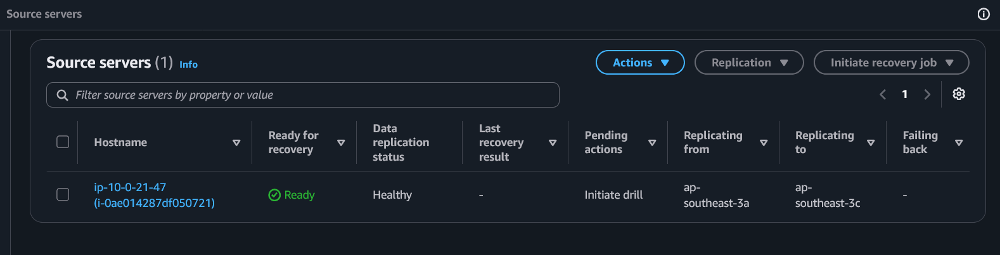

### Step 2 — Review the launch settings

Open the source server and go to the **Launch settings** tab. Review the **DRS launch
settings** (start instance upon launch, right sizing, etc.) and the **EC2 launch
template** (subnet, security groups, instance type). This is what DRS uses when it
launches a recovery instance.

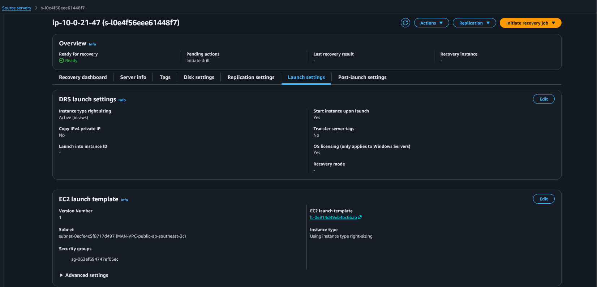

### Step 3 — (Optional) Run a recovery drill first

Use **Initiate recovery job → Initiate recovery drill** for a non-disruptive test.
A drill launches a separate recovery instance without touching the source, so you can
validate the process before a real recovery.

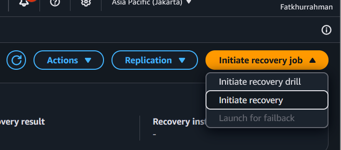

### Step 4 — Select a point in time (PIT)

Choose the snapshot to recover from. **Use most recent data** gives you the latest
replicated state; or pick a specific timestamp from the list of points in time.

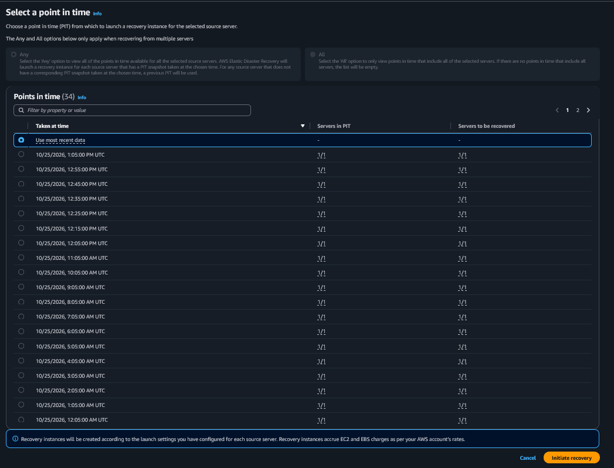

### Step 5 — Verify the drill succeeded

Back on the source server, the **Replication** menu now offers **Protect recovered
instance**, and **Last recovery result** shows **Successful**. This confirms the drill
worked end to end.

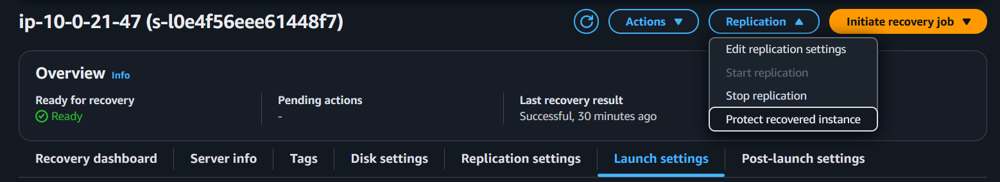

---

## Part 3 — Recover INTO the existing instance

Instead of letting DRS spin up a brand-new instance, this practice recovers **into the
original Terraform-managed instance** (`i-0ae014287df050721` / `ec2-drs-practice-nginx`).
That keeps the same instance id and lets us compare the EBS root volume before and after.

### Step 6 — Review DRS launch settings before editing

On the **Launch settings** tab, open **DRS launch settings**. Note `Launch into
instance ID` is currently empty (`-`) — DRS would otherwise create a new instance.

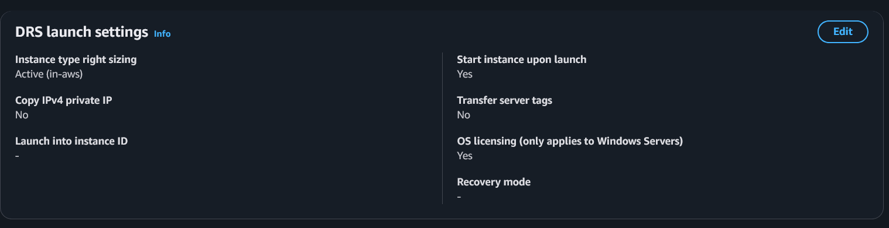

### Step 7 — Tag the target instance

For DRS to launch into an existing instance, that instance must carry the tag
`AWSDRS = AllowLaunchingIntoThisInstance`. In the EC2 console, open the target
instance → **Manage tags** and add it alongside the existing `Name` tag.

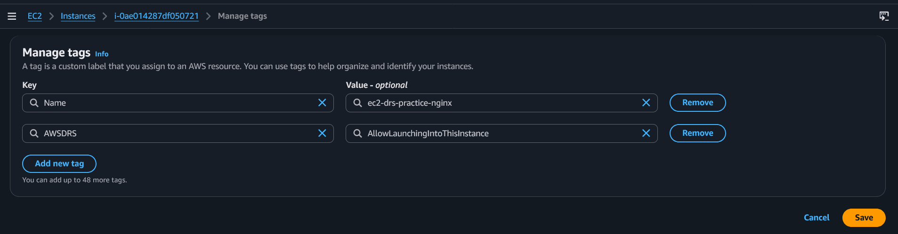

### Step 8 — Set "Launch into instance ID"

Back in **Edit DRS launch settings**, the tagged instance now appears in the **Launch
into instance ID** dropdown. Select it. (Only instances with the
`AWSDRS:AllowLaunchingIntoThisInstance` tag are listed. Their disks are replaced with
new disks during launch.)

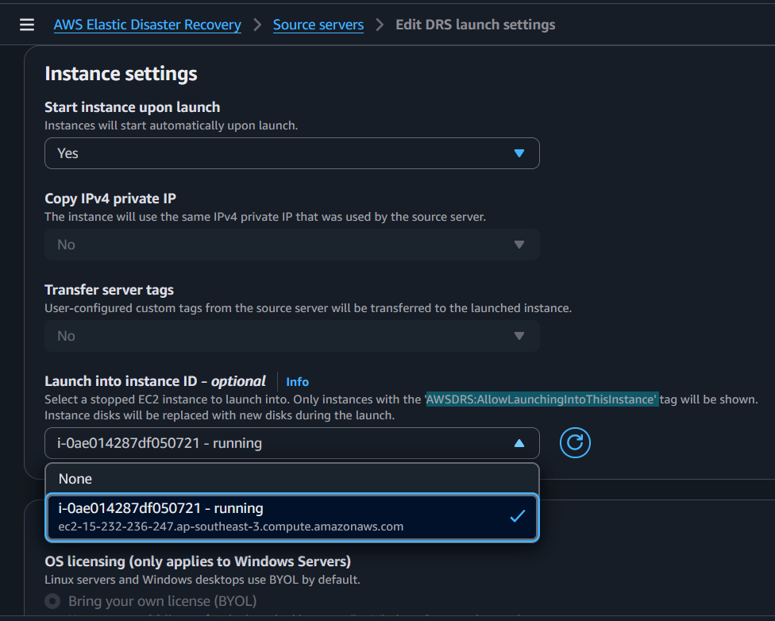

### Step 9 — Confirm settings saved and start the recovery

A green banner confirms **DRS launch settings updated**. Now use **Initiate recovery
job → Initiate recovery** (the real recovery, not a drill).

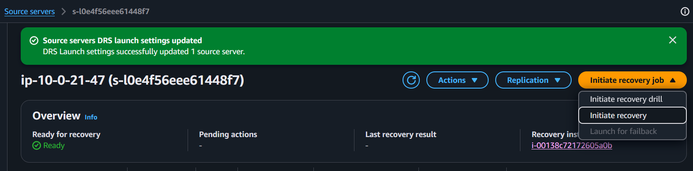

### Step 10 — Verify the applied launch settings

After saving, the **Launch settings** tab reflects the change: **Launch into instance
ID = i-0ae014287df050721**, **Recovery mode = Optimal**, and the subnet/SG from the
updated EC2 launch template (now at a higher version number).

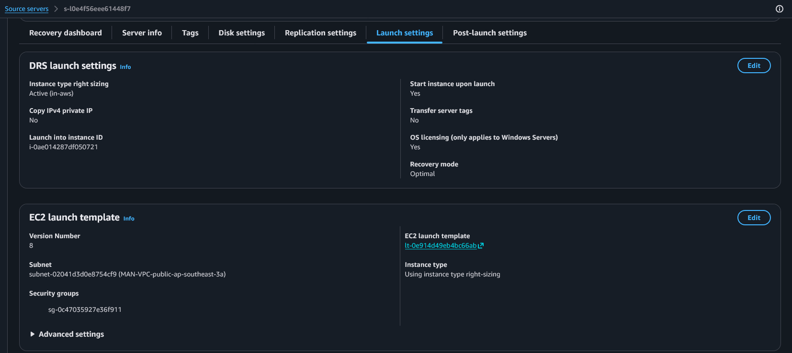

### Step 11 — Record the "before" state of the target instance

Before recovery completes, look at the target instance summary: it's **Running** with
public IP `15.232.236.247`. Note this is the pre-recovery state.

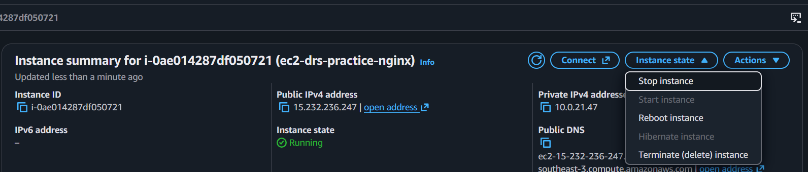

### Step 12 — Note the original root volume

On the instance's **Storage** tab, record the current root volume id
(`vol-02a2b785e95ac5a33`, `/dev/sda1`, **unencrypted**). This is the "before" disk that
DRS will replace.

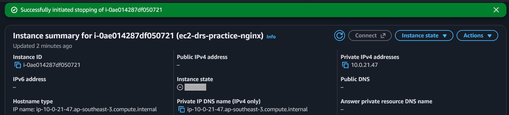

### Step 13 — Stop the instance if required

DRS replaces the disks during a launch-into-existing-instance recovery, so the target
must be stopped. Use **Instance state → Stop instance** and confirm.

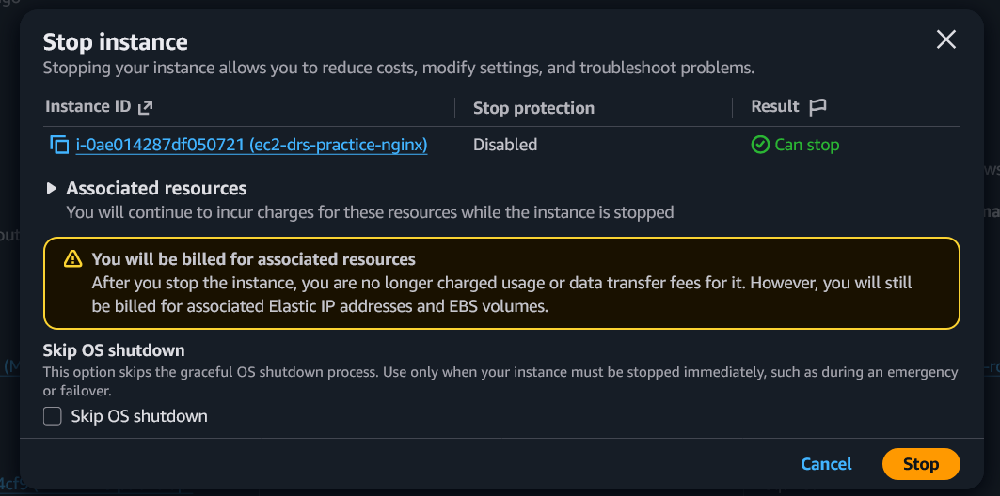

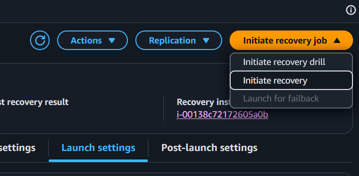

### Step 14 — Trigger the recovery

With the target prepared, run **Initiate recovery job → Initiate recovery** and pick the
point in time. DRS launches the recovered disks into the existing instance id.

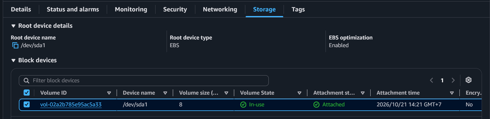

### Step 15 — Verify the "after" state

Once recovery finishes, check the instance's **Storage** tab again. The root volume is
now a **new** volume (`vol-0253e995853095e66`), attached at the recovery time, and
**encrypted** — proof that DRS swapped in the recovered disk while keeping the same
instance id (`i-0ae014287df050721` / `ec2-drs-practice-nginx`).

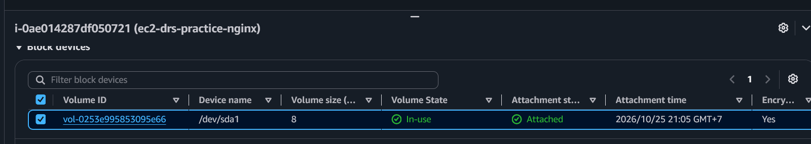

---

## Part 4 — Manage the DRS recovery resources in Terraform (optional)

The `drs-recovery/` project imports the DRS-launched recovery resources so you can see
them in Terraform without letting Terraform fight DRS for ownership.

```bash
cd drs-recovery
terraform init
terraform plan   # imports via import {} blocks, shows no destructive changes
terraform apply
```

Key design points (see `drs-recovery/recovery.tf`):

- **Separate state** from `source-nginx/`, so the source and recovery instances are
  managed independently.
- **`prevent_destroy = true`** on every resource — Terraform refuses to delete
  DRS-owned infrastructure.
- **`ignore_changes`** on DRS-managed attributes — Terraform won't revert drift that
  DRS introduces.

> **Ownership caveat:** DRS controls the recovery instance's lifecycle. A new recovery
> or failback job **terminates** the current recovery instance and launches a
> replacement with **new ids**. When that happens, the imported state goes stale.
> Update the ids in `drs-recovery/terraform.tfvars` (or `variables.tf`),
> `terraform state rm` the stale resources, then re-run `terraform plan` to re-import.

## Cleanup

- **Source project:** `cd source-nginx && terraform destroy`.
- **Recovery resources:** these are DRS-owned and guarded by `prevent_destroy`. Clean
  them up from the **DRS console** (and stop replication) rather than via
  `terraform destroy`.
